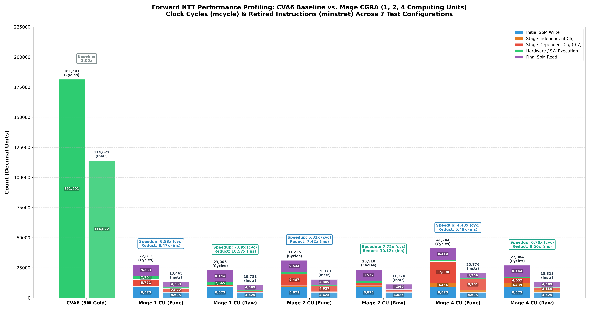

# CVA6 RISC-V CPU 

This repo has been cloned [from the original one](https://github.com/openhwfoundation/cva6/tree/v5.3.0) at the release `v5.3.0`:

> CVA6 is a 6-stage, single-issue, in-order CPU which implements the 64-bit RISC-V instruction set. It fully implements I, M, A and C extensions as specified in Volume I: User-Level ISA V 2.3 as well as the draft privilege extension 1.10. It implements three privilege levels M, S, U to fully support a Unix-like operating system. Furthermore, it is compliant to the draft external debug spec 0.13.

## Quick setup

Assumptions:
- You have `git`, `python3` and `cmake` (version 3.14 or higher) installed.
- You want to install the standard configuration.
- You have admin priviledges.

Procedure:
1. Run in the root directory :
```Bash
make -f Mkf.setup firstsetup
```
2. Export the environment variables:
```Bash
source setup-env.sh
```
3. Perform the Hello World test:
```Bash
cd ./verif/sim

python3 cva6.py --target cv32a60x --iss=$DV_SIMULATORS --iss_yaml=cva6.yaml \
--c_tests ../tests/custom/hello_world/hello_world.c \
--linker=../../config/gen_from_riscv_config/linker/link.ld \
--gcc_opts="-static -mcmodel=medany -fvisibility=hidden -nostdlib \
-nostartfiles -g ../tests/custom/common/syscalls.c \
../tests/custom/common/crt.S -lgcc \
-I../tests/custom/env -I../tests/custom/common"
```
4. Perform a standard test on Mage:
```Bash
cd ./verif/sim

make magesim-bank_transfer
```

## Running standalone simulations of Mage

Before starting the simulation export the `DV_SIMULATORS` environment variable as:
```Bash
export DV_SIMULATORS="veri-testharness"
```
This is unnecessary if you've already executed `source setup-env.sh` from the root directory (which is strongly suggested).

You can run the simulation **from the `./verif/sim` directory**:

```Bash
make magesim TAR=<path to file in directory ../tests/custom/mage_tests/>
```
e.g.
```Bash
make magesim TAR=bank_transfer/bank_transfer.c
```
or to run NTT tests:
```Bash
make magesim TAR=ntt4u/ntt4u.c
```

### Automatic Configuration Validation
Each Mage C test program specifies the hardware configuration it expects via a comment placed near the top of the file:
```C
// MAGE_CFG_HJSON = ips/Mage-and-Rogue/config/dae/<config_file>.hjson
```

When you launch `make magesim`, an automated pre-simulation check verifies whether the test matches the configuration currently attached to the SoC. If there is a mismatch or missing configuration, a clear warning is displayed:
- **Mismatched configuration**: The test expects a different configuration than the one currently attached to the SoC.
- **Mage detached**: Mage is not attached to the SoC (`mage-detach` has been run).
- **Missing tag**: The C test does not specify an expected configuration.
- **Software/RTL desynchronization**: The configuration attached to the SoC differs from the one generated in `ips/Mage-and-Rogue/sw/mage.h`.

When everything matches, you will see a green confirmation before the simulation starts:
```text
[INFO] Mage configuration match: cfg_ntt_4u_3stream.hjson
       Test file: verif/tests/custom/mage_tests/ntt4u/ntt4u.c
       Attached : ips/Mage-and-Rogue/config/dae/cfg_ntt_4u_3stream.hjson
```

## Logs

The logs from cva6.py are located in `./verif/sim/out_YEAR-MONTH-DAY`. Here is the log directory hierarchy:

- **directed_asm_tests/**: The compiled (to .o then .bin) assembly tests
- **directed_c_tests/**: The compiled (to .o then .bin) c tests
- **spike_sim/**: Spike simulation log and trace files
- **veri_testharness_sim**: Verilator simulation log and trace files
- **iss_regr.log**: The regression test log 

The regression test log summarizes the comparison between the simulator trace and the Spike trace. Be aware that a if a test fails before the comparison step, it will not appear in this log, check the output of cva6.py and the logs of the simulation instead.

**Note: If the `main()` function returns a non-zero value the simulation stops without any log file for debug.** A simulation workflow can include two phases:
1. Run the test returning the number of errors at the end. This confirms wether the test was successful or not. 
2. Run the same test again returning `0` at the end to generate log files.

## Waveform generation

Waveform generation is currently supported for Verilator (`veri-testharness`)
and VCS with full UVM testbench (`vcs-uvm`) simulation types.  It is disabled
by default to save simulation time and storage space.

To enable waveform generation for a supported simulation mode, set either
of the two shell variables that control tracing before running any of the
test scripts under `verif/regress`:
- `export TRACE_FAST=1` enables "fast" waveform generation (keep simulation
   time low at the expense of space).  This will produce VCD files when using
   Verilator, and VPD files when using Synopsys VCS with UVM testbench (`vcs-uvm`).
- `export TRACE_COMPACT=1` enables "compact" waveform generation (keep waveform
   files smaller at the expense of increased simulation time).  This will
   produce FST files when using Verilator, and FSDB files when using Synopsys
   VCS with UVM testbench (`vcs-uvm`).

To generate VCD waveforms of the `smoke-tests` regression suite using Verilator, use:
```Bash
export TRACE_COMPACT=1
bash verif/regress/smoke-tests-<cpu_version>.sh
```

Where `<cpu_version>` is one of the following, depending on the CPU variant you want to use.
- `cv32a65x`.
- `cv32a6_imac_sv32`.
- `cv64a6_imafdc_sv39`.

After each simulation run involving Verilator or VCS, the generated waveforms
will be copied  to the directory containing the log files (see above,) with
the name of the current HW configuration added to the file name right before
the file type suffix (e.g., `I-ADD-01.cv32a60x.vcd`).


## Directory Structure:

The directory structure separates the CVA6 RISC-V CPU core from the CORE-V-APU FPGA Emulation Platform.
Files, directories and submodules under `cva6` are for the core _only_ and should not have any dependencies on the APU.
Files, directories and submodules under `corev_apu` are for the FPGA Emulation platform.
The CVA6 core can be compiled stand-alone, and obviously the APU is dependent on the core.

The top-level directories of this repo:
* **ci**: Scriptware for CI.
* **common**: Source code used by both the CVA6 Core and the COREV APU. Subdirectories from here are `local` for common files that are hosted in this repo and `submodules` that are hosted in other repos.
* **core**: Source code for the CVA6 Core only. There should be no sources in this directory used to build anything other than the CVA6 core.
* **corev_apu**: Source code for the CVA6 APU, exclusive of the CVA6 core. There should be no sources in this directory used to build the CVA6 core.
* **docs**: Documentation.
* **pd**: Example and CI scripts to synthesis CVA6.
* **util**: General utility scriptware.
* **vendor**: Third-party IP maintained outside the repository.
* **verif**: Verification environment for the CVA6. The verification files shared with other cores are in the [core-v-verif](https://github.com/openhwgroup/core-v-verif) repository on GitHub. core-v-verif is defined as a cva6 submodule.
* **ips**: External IPs ([Mage-and-Rogue](#mage-and-rogue-ip))

### verif Directories

- **bsp**:     board support package for test-programs compiled/assembled/linked for the CVA6.
This BSP is used by both `core` testbench and `uvmt_cva6` UVM verification environment.
- **regress**: scripts to install tools, test suites, CVA6 code and to execute tests
- **sim**:     simulation environment (e.g. riscv-dv)
- **tb**:      testbench module instancing the core
- **tests**:   source of test cases and test lists

## [Mage-and-Rogue IP](https://github.com/edge-group-polito/Mage-and-Rogue)

### Attach/Detach Mage to/from the SoC

1. From the `ips/Mage-and-Rogue` directory, generate Mage RTL and software headers for the desired configuration:
```Bash
make mage-gen [MAGE_CFG_HJSON=<path to config.hjson>]
```
For example, to configure Mage for 4 parallel NTT computing units:
```Bash
make mage-gen MAGE_CFG_HJSON=config/dae/cfg_ntt_4u_3stream.hjson
```
If `MAGE_CFG_HJSON` is omitted, the default `config/dae/cfg_2x2_2x2_full.hjson` is generated.

2. From the root directory, attach Mage to the CVA6 SoC:
```Bash
python3 mage-attach
```
> **Tip:** Running `python3 mage-attach` without arguments automatically detects and attaches the configuration you just generated in step 1! You can also explicitly specify a configuration:
```Bash
python3 mage-attach -c <path to config.hjson>
```

3. Re-verilate the CVA6 SoC harness with the updated Mage configuration:
```Bash
make verilate verilator='verilator --no-timing' target=cv32a60x defines=
```

4. Check the current attachment status at any time:
```Bash
python3 mage-attach --status
```
This command displays whether Mage is attached, the active configuration, SpM bank count, total scratchpad size, memory map, and verifies alignment with `sw/mage.h`.

5. Execute your simulation (see [Running standalone simulations of Mage](#running-standalone-simulations-of-mage)).

6. When finished, or before running non-Mage tests, detach Mage to restore pristine SoC files:
```Bash
python3 mage-detach
```

### Preliminary results

Mage's performance running NTT algorithm: 